# AgentFlow: Master Exhaustive Line-by-Line Code & Architecture Guide

> **Scope**: Phases 1, 2, and 3 Complete Codebase (All 28 Production Files)  
> **Repository Path**: `c:\work\ai store\no name project\agentflow\backend`  
> **Verification Status**: 119/119 Tests Passing, 0 Lint Warnings

---

## Guide Structure & Complete Chapters

To ensure maximum depth, uncompromised readability, and zero truncation, the line-by-line breakdown is organized into four exhaustive chapters:

### 📖 [Chapter 1: Configuration, Logging & Core Pydantic Contracts](file:///c:/work/ai%20store/no%20name%20project/agentflow/docs/exhaustive_code_guide/PART_1_CONFIG_AND_SCHEMAS.md)
- `src/agentflow/config.py`: Application BaseSettings, environment variable coercion, budget and step limits.
- `src/agentflow/logging_config.py`: Structlog pipeline, ISO timestamps, console vs JSON renderers.
- `src/agentflow/core/schemas/tool.py`: `ToolDef` and `ToolResult` interface contracts.
- `src/agentflow/core/schemas/workflow.py`: `AgentType`, `NodeDef`, `EdgeDef`, `AgentMessage`, `RunRecord`, `NodeRunRecord`, `JoinPolicy`, `RetryPolicy`.

### 📖 [Chapter 2: The Topological Execution Engine](file:///c:/work/ai%20store/no%20name%20project/agentflow/docs/exhaustive_code_guide/PART_2_EXECUTION_ENGINE.md)
- `src/agentflow/core/executor/context.py`: `RunContext`, shared context, cost tracking, step limits.
- `src/agentflow/core/executor/graph.py`: Kahn's topological sort, execution layers, DAG validation, cycle detection.
- `src/agentflow/core/executor/mapping.py`: `OutputWrapper`, safe `evaluate_condition`, parameter mapping templates.
- `src/agentflow/core/executor/node_runner.py`: `run_node`, exponential backoff retry loop, validation feedback injection, timeouts.
- `src/agentflow/core/executor/runner.py`: `run_workflow`, dynamic ready set, parallel execution, Dead-Path Elimination (DPE), Join Policies (`WAIT_ALL` / `WAIT_ANY`), default edge routing, self-healing loop reachability intersection (`_find_cycle_nodes`), error recovery routing.

### 📖 [Chapter 3: LLM Gateway, Tools & The ReAct Loop](file:///c:/work/ai%20store/no%20name%20project/agentflow/docs/exhaustive_code_guide/PART_3_LLM_GATEWAY_AND_TOOLS.md)
- `src/agentflow/core/llm/client.py`: Multi-provider LiteLLM client, cost tracking, JSON mode detection.
- `src/agentflow/core/llm/structured.py`: `complete_structured`, markdown stripping, self-healing Pydantic schema auto-repair.
- `src/agentflow/core/tools/base.py`: `BaseTool` abstract base class and OpenAI tool format serializer.
- `src/agentflow/core/tools/registry.py`: `ToolRegistry` singleton and `register_all_builtin_tools`.
- `src/agentflow/core/tools/credentials.py`: `CredentialStore`, Fernet symmetric encryption (`AES-128-CBC` + `HMAC-SHA256`), ephemeral injection.
- `src/agentflow/core/tools/tool_loop.py`: Multi-turn ReAct autonomous tool calling loop with step limits and prompt injection defense.
- `src/agentflow/core/tools/web_search.py`: Google Serper.dev REST API + DuckDuckGo search + offline mock fallback.
- `src/agentflow/core/tools/http_tool.py`: Httpx async REST client supporting GET, POST, PUT, DELETE.
- `src/agentflow/core/tools/email_tool.py`: SendGrid REST API, SMTP TLS, and stub dry-run mode.

### 📖 [Chapter 4: Agents, Workflows & Production Scripts](file:///c:/work/ai%20store/no%20name%20project/agentflow/docs/exhaustive_code_guide/PART_4_AGENTS_AND_WORKFLOWS.md)
- `src/agentflow/core/agents/base.py`: `BaseAgent`, `AgentContext`, `AgentResult`.
- `src/agentflow/core/agents/registry.py`: `AgentRegistry` and built-in agent registration.
- `src/agentflow/core/agents/trigger/manual.py`: Manual trigger node emitting workflow parameters.
- `src/agentflow/core/agents/research/research_agent.py`: Lead research agent querying web search or synthesizing findings.
- `src/agentflow/core/agents/classifier/classifier_agent.py`: ICP qualification router scoring leads and setting branch directions.
- `src/agentflow/core/agents/writer/writer_agent.py`: Cold outreach writer with dynamic editorial revision prompt injection.
- `src/agentflow/core/agents/reviewer/reviewer_agent.py`: Quality gate scoring drafts and emitting actionable improvement critiques.
- `src/agentflow/core/agents/email/email_agent.py`: Action agent executing outbound email dispatch.
- `src/agentflow/core/workflows/demo_workflow.py`: The complete 6-node production DAG with feedback loops and branching.
- `src/agentflow/scripts/run_demo.py`: CLI harness for running workflows in live or offline `--mock` mode.

---

## Visual Diagrams & Master Architecture Graphs

### 1. File-by-File Learning & Dependency Graph (From File 1 to File 24)

```mermaid
flowchart TD
    classDef contract fill:#e1f5fe,stroke:#0288d1,stroke-width:2px;
    classDef llm fill:#f3e5f5,stroke:#7b1fa2,stroke-width:2px;
    classDef tools fill:#e8f5e9,stroke:#388e3c,stroke-width:2px;
    classDef agents fill:#fff3e0,stroke:#f57c00,stroke-width:2px;
    classDef engine fill:#ffebee,stroke:#d32f2f,stroke-width:2px;
    classDef workflow fill:#fce4ec,stroke:#c2185b,stroke-width:2px;

    subgraph Step1["Step 1: Foundational Data Contracts"]
        F1["1. config.py<br/>(Settings & Budgets)"]:::contract
        F2["2. schemas/tool.py<br/>(ToolDef & ToolResult)"]:::contract
        F3["3. schemas/workflow.py<br/>(NodeDef, EdgeDef, AgentMessage)"]:::contract
        F1 --> F3
        F2 --> F3
    end

    subgraph Step2["Step 2: LLM Gateway & Structured Parser"]
        F4["4. llm/client.py<br/>(LiteLLM Provider Gateway)"]:::llm
        F5["5. llm/structured.py<br/>(Pydantic JSON & Auto-Repair)"]:::llm
        F1 --> F4
        F4 --> F5
        F3 --> F5
    end

    subgraph Step3["Step 3: Tools & Cryptographic Security Vault"]
        F6["6. tools/base.py<br/>(BaseTool & OpenAI Schema)"]:::tools
        F7["7. tools/credentials.py<br/>(Fernet AES Cryptographic Vault)"]:::tools
        F8["8. tools/registry.py<br/>(ToolRegistry Singleton)"]:::tools
        F9["9. tools/tool_loop.py<br/>(ReAct Reasoning & Injection Defense)"]:::tools
        F10["10. Concrete Tools<br/>(web_search, http_tool, email_tool)"]:::tools
        F2 --> F6
        F1 --> F7
        F6 --> F8
        F7 --> F8
        F6 --> F9
        F4 --> F9
        F8 --> F10
    end

    subgraph Step4["Step 4: The Autonomous Agents"]
        F11["11. agents/base.py & registry.py<br/>(BaseAgent & AgentRegistry)"]:::agents
        F12["12. trigger/manual.py<br/>(Workflow Seed Trigger)"]:::agents
        F13["13. research/research_agent.py<br/>(Web Intelligence Gathering)"]:::agents
        F14["14. classifier/classifier_agent.py<br/>(ICP Scoring & Branch Router)"]:::agents
        F15["15. writer/writer_agent.py<br/>(Personalized Copy & Revision)"]:::agents
        F16["16. reviewer/reviewer_agent.py<br/>(Editorial QA & Feedback)"]:::agents
        F17["17. email/email_agent.py<br/>(Action Dispatch Agent)"]:::agents
        F3 --> F11
        F5 --> F11
        F11 --> F12
        F11 --> F13
        F11 --> F14
        F11 --> F15
        F11 --> F16
        F11 --> F17
        F9 --> F13
        F10 --> F17
    end

    subgraph Step5["Step 5: The Topological Execution Engine"]
        F18["18. executor/context.py<br/>(RunContext, Budget & Step Guards)"]:::engine
        F19["19. executor/graph.py<br/>(Kahn's Topological Layers & Cycle Check)"]:::engine
        F20["20. executor/mapping.py<br/>(OutputWrapper & evaluate_condition)"]:::engine
        F21["21. executor/node_runner.py<br/>(run_node, Retries & Timeouts)"]:::engine
        F22["22. executor/runner.py<br/>(DPE, Feedback Loops & Join Policies)"]:::engine
        F3 --> F18
        F3 --> F19
        F18 --> F20
        F11 --> F21
        F8 --> F21
        F18 --> F21
        F19 --> F22
        F20 --> F22
        F21 --> F22
    end

    subgraph Step6["Step 6: Production Pipeline Assembly & CLI"]
        F23["23. workflows/demo_workflow.py<br/>(6-Node DAG Specification)"]:::workflow
        F24["24. scripts/run_demo.py<br/>(CLI Execution Harness & Mock Mode)"]:::workflow
        F3 --> F23
        F22 --> F24
        F23 --> F24
    end
```



---

### 2. Runtime Execution & Dynamic Control-Flow Architecture

```mermaid
flowchart TD
    subgraph UI_REST["Client & Persistence Layer (Phase 4 & 5)"]
        Canvas["React Flow Canvas"] --> REST["FastAPI API"]
        REST --> DB[(PostgreSQL)]
        REST --> ArqQueue[(Redis / Arq Worker)]
    end

    subgraph CoreEngine["AgentFlow Engine Core (Phases 1 - 3)"]
        WDef["WorkflowDef (Pydantic Spec)"] --> GraphBuilder["build_execution_graph()"]
        GraphBuilder -->|"Forward DAG Layers"| Runner["WorkflowRunner (Dynamic Frontier)"]

        subgraph DynamicExecutionLoop["Dynamic Step Execution"]
            Runner -->|"1. Resolve Ready Nodes"| NodeRunner["run_node()"]
            NodeRunner -->|"2. Resolve Agent"| Agent["BaseAgent Plugin"]
            NodeRunner -->|"3. Resolve Tools & Inject Decrypted Keys"| ToolRegistry["ToolRegistry + CredentialStore"]
            ToolRegistry -->|"4. Execute Tool Loop"| ToolLoop["ToolLoop (ReAct)"]
            ToolLoop -->|"5. Model Call"| LiteLLM["LiteLLM Client"]
            LiteLLM -->|"6. Structured Output Parse"| Parser["StructuredOutputParser"]
        end

        Parser -->|"7. Emit AgentMessage"| Context["RunContext"]
        Context -->|"8. Edge Evaluation & DPE"| ControlFlow{"Control Flow Engine"}

        ControlFlow -->|"Condition True"| SatisfiedEdge["satisfied_edges.add(edge.id)"]
        ControlFlow -->|"Condition False"| DeadEdge["dead_edges.add(edge.id)"]
        ControlFlow -->|"All False -> is_default"| DefaultEdge["satisfied_edges.add(default_edge.id)"]
        ControlFlow -->|"is_feedback (Loop)"| CycleReset["_find_cycle_nodes() Reset"]
        ControlFlow -->|"Node Failed -> is_error_handler"| ErrorPath["Route to Error Handler"]

        SatisfiedEdge --> Runner
        DeadEdge --> DPE["Cascade Dead Path Elimination"]
        DPE --> Runner
        CycleReset --> Runner
    end
```



---

### 3. Production Demo Pipeline DAG (6 Nodes with Feedback Loop & Branching)

```mermaid
flowchart LR
    classDef nodeStyle fill:#ffffff,stroke:#1e88e5,stroke-width:2px,rx:8,ry:8;
    classDef loopStyle fill:#fff8e1,stroke:#fbc02d,stroke-width:2px,stroke-dasharray: 5 5;
    classDef branchStyle fill:#e8f5e9,stroke:#43a047,stroke-width:2px;

    N1["<b>1. Trigger Manual</b><br/>(Lead Input)"]:::nodeStyle
    N2["<b>2. Research Agent</b><br/>(WebSearch Tool)"]:::nodeStyle
    N3["<b>3. Classifier Router</b><br/>(ICP Scoring 1-10)"]:::nodeStyle
    N4["<b>4. Writer Agent</b><br/>(Drafts Outreach Copy)"]:::nodeStyle
    N5["<b>5. Reviewer Agent</b><br/>(QA & Critique Gate)"]:::nodeStyle
    N6["<b>6. Email Agent</b><br/>(SendGrid / Stub)"]:::nodeStyle
    N_Unqual["<b>Discard / Log</b><br/>(Low Priority Lead)"]:::branchStyle

    N1 -->|"Unconditional"| N2
    N2 -->|"Pass Findings"| N3
    
    N3 -->|"score >= 7.0<br/>(Qualified Branch)"| N4
    N3 -.->|"score < 7.0<br/>(Default Fallback)"| N_Unqual

    N4 -->|"Initial Draft"| N5
    
    N5 ==>|"is_feedback=True<br/>not output.passed and score < 8<br/>[Editorial Revision Loop]"| N4
    
    N5 -->|"output.passed == True<br/>(Score >= 8.0 Approved)"| N6
```



---

## Test & Quality Verification

```powershell
pytest tests/
# Result: 119 passed in 3.41s

ruff check .
# Result: All checks passed! 0 errors, 0 warnings
```
